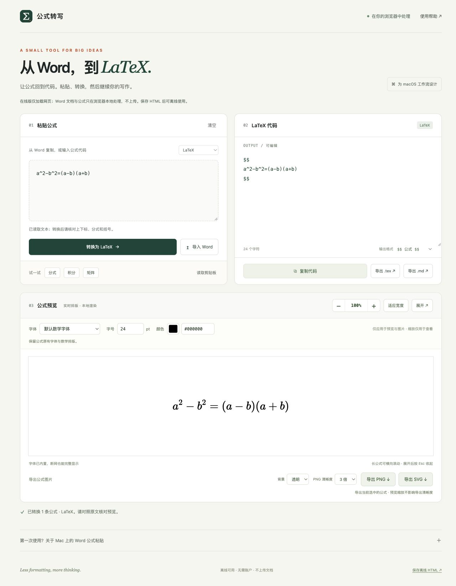

<p align="center">
  
</p>

# Word 公式转 LaTeX · Offline Word Equation to LaTeX

[中文](#中文) | [English](#english)

**[打开网页版 / Open the web app →](https://qiukefan.github.io/word-equation-latex/)**



<a id="中文"></a>
## 中文

将 Word 原生公式、MathML、Unicode 公式或 LaTeX 转成可编辑的 LaTeX 代码，实时预览并导出图片。所有处理均在本机浏览器内完成。

### 直接使用

1. 用 Chrome、Edge 或 Safari 打开 **[在线应用](https://qiukefan.github.io/word-equation-latex/)**。
2. 从 Word 复制公式后粘贴，或选择 `.docx` 文件提取公式。
3. 选择字体、字号和颜色，复制代码或导出结果。

需要完全断网使用时，点击网页底部的“保存离线 HTML”，以后直接打开保存的文件。也可以下载仓库（**Code → Download ZIP**）并解压，双击 [`Word公式转LaTeX.html`](Word公式转LaTeX.html)。HTML 内嵌全部脚本和字体，无需安装 Node.js、启动服务器、登录或调用在线 API。浏览器若无法取得 Word 的原生剪贴板数据，可使用本地 DOCX 导入。

### 在线访问与文档隐私

- 打开网页版时，浏览器会从 GitHub Pages 下载网页。GitHub 会收到正常的网页访问请求；这与上传 Word 文档不同。
- 选择的 DOCX 和粘贴的公式仅在本机浏览器内存中解析、转换和排版，不会发送给 GitHub 或其他服务器。
- 应用没有文档上传接口、云端转换服务或分析追踪脚本。页面的内容安全策略包含 `connect-src 'none'`，阻止应用脚本发起网络连接；脚本、排版库和字体均内嵌。
- 下载离线 HTML 后，直接打开本地文件即可使用，不需要再访问 GitHub Pages。

### 功能

- 解析 Word 原生公式（OMML）、MathML，以及部分 Unicode 线性公式；支持输入和编辑 LaTeX。
- 本地读取 DOCX，逐条选择公式，编辑和复制 LaTeX。
- 内置 11 种数学字体样式，4–96 pt 字号和十六进制颜色。
- 实时排版、缩放和适应宽度；缩放仅影响查看。
- 导出当前公式的 PNG 和 SVG，使用所选字体、字号和颜色；支持透明或白色背景，PNG 支持清晰度设置。
- 导出全部公式为 `.tex` 或 `.md`；`.tex` 遵循所选输出包裹格式，Markdown 使用 `$$` 数学块。

字体、字号和颜色设置用于预览与图片，不会改写可编辑的 LaTeX 源码。

### 限制

- 仅作为图片复制的公式不包含可转换的公式结构，此应用不提供 OCR。
- Word 剪贴板提供的数据取决于 Word 版本、复制方式和浏览器；粘贴不可用时请尝试 DOCX 导入。
- 字体菜单提供 TeX 数学字形样式，并非系统字体列表。不同样式的可用字符范围不同，界面会提示；未覆盖字符保留适用的数学字形。
- Unicode 线性公式转换属于有限支持。复杂 Word 排版、特殊宏和转换结果仍建议逐式核对；预览不支持全部 LaTeX 命令或宏包。

### 从源码构建

需要 Python 3，无额外 Python 依赖。所有第三方脚本、CSS 和字体已放在 `vendor/`，构建也可离线完成。

```sh
python3 build.py
```

生成 `Word公式转LaTeX.html`、`dist/index.html` 和 `docs/index.html`，三者内容相同；同时生成 `docs/.nojekyll`。

- `src/`：界面、公式转换、DOCX 读取、字体和图片导出。
- `vendor/`：KaTeX 0.16.22、fflate 0.8.3、MathJax 3.2.2 及字体。
- `tests/`：合成公式与浏览器测试页，不包含用户文档。
- `docs/`：GitHub Pages 使用的静态网页。
- `assets/`：README 中的 Logo 与网页预览图。

### GitHub Pages 部署

仓库的 **Settings → Pages → Build and deployment** 使用 **Deploy from a branch**，来源为 **`main` 分支的 `/docs` 目录**。修改源码后运行 `python3 build.py`，将源码和构建产物一同提交到 `main`；GitHub Pages 会发布更新。运行应用不需要服务器端代码，也不需要配置 API 密钥。

### 测试

先构建 HTML，再在仓库根目录启动仅监听本机的服务器：

```sh
python3 -m http.server 8000 --bind 127.0.0.1
```

在浏览器打开 `http://127.0.0.1:8000/tests/` 下的测试页，查看页面显示的通过和失败结果：

| 测试页 | 检查内容 |
| --- | --- |
| `regression.html` | 公式结构转换 |
| `integration.html` | 应用交互与合成剪贴板输入 |
| `preview.html` | 公式预览 |
| `export.html` | 图片导出 |
| `typography.html` | 字号与颜色 |
| `fonts.html` | 字体选择与导出 |
| `privacy.html` | 本地 DOCX 处理与网络连接限制 |

本地服务器只用于开发测试，日常使用不需要。测试使用合成数据，不需要上传或提供个人 Word 文档。

### Illustrator 插件

可停靠的 Illustrator 面板及“插入当前画板”功能维护在独立仓库：
[Word Equation Illustrator](https://github.com/qiukefan/word-equation-illustrator)。

### 第三方许可证

仓库保留 [KaTeX（MIT）](vendor/KATEX-LICENSE.txt)、[fflate（MIT）](vendor/FFLATE-LICENSE.txt)、[MathJax（Apache-2.0）](vendor/MATHJAX-LICENSE.txt) 的许可证，构建后的 HTML 也内嵌这些许可证。此仓库没有为原创代码另行授予开源许可证。

[English](#english)

---

<a id="english"></a>
## English

Convert native Word equations, MathML, Unicode equations, or LaTeX into editable LaTeX, preview the result, and export equation images. All equation and document processing happens locally in your browser.

### Quick start

1. Open the **[web app](https://qiukefan.github.io/word-equation-latex/)** in Chrome, Edge, or Safari.
2. Paste an equation copied from Word, or select a `.docx` file to extract its equations.
3. Choose a font style, size, and color, then copy the code or export the result.

For fully offline use, click “保存离线 HTML” (Save offline HTML) at the bottom of the page, then open that saved file whenever you need it. Alternatively, download the repository with **Code → Download ZIP**, extract it, and open [`Word公式转LaTeX.html`](Word公式转LaTeX.html). The HTML embeds all scripts and fonts. No Node.js installation, server, account, or online API is required. If the browser cannot access Word's native clipboard equation data, use the local DOCX importer.

### Online access and document privacy

- Opening the hosted version downloads the page from GitHub Pages. GitHub receives normal website access requests; these do not contain your Word document.
- Selected DOCX files and pasted equations are parsed, converted, and typeset only in local browser memory. They are not sent to GitHub or another server.
- The app has no document-upload endpoint, cloud conversion service, or analytics scripts. Its Content Security Policy includes `connect-src 'none'` to block script-initiated network connections. Scripts, typesetting libraries, and fonts are embedded.
- After downloading the offline HTML, you can open the local file without visiting GitHub Pages again.

### Features

- Parse native Word equations (OMML), MathML, and a subset of Unicode linear equations; enter and edit LaTeX directly.
- Read DOCX files locally, select individual equations, and edit or copy their LaTeX.
- Choose from 11 built-in mathematical font styles, sizes from 4 to 96 pt, and hexadecimal colors.
- Preview equations as you edit, zoom, and fit to width; zoom affects viewing only.
- Export the selected equation as PNG or SVG using the selected font style, size, and color. Transparent and white backgrounds are available, with a resolution setting for PNG.
- Export all equations as `.tex` or `.md`. The `.tex` export follows the selected math delimiter format; Markdown uses `$$` math blocks.

Font style, size, and color settings apply to previews and images without rewriting the editable LaTeX source.

### Limitations

- Equations copied only as images do not contain convertible equation structure. OCR is not included.
- Available clipboard data depends on the Word version, copy method, and browser. Try DOCX import when pasting does not work.
- The font menu offers TeX mathematical styles, not installed system fonts. Character coverage varies by style; the interface explains these limits, and uncovered characters retain suitable mathematical glyphs.
- Unicode linear equation conversion has limited coverage. Check complex Word layouts, custom macros, and converted equations against the originals. The preview does not support every LaTeX command or package.

### Build from source

Python 3 is required, with no additional Python dependencies. Third-party scripts, CSS, and fonts are included in `vendor/`, so building also works offline.

```sh
python3 build.py
```

This generates `Word公式转LaTeX.html`, `dist/index.html`, and `docs/index.html` with identical contents, plus `docs/.nojekyll`.

- `src/`: interface, equation conversion, DOCX reader, font styles, and image export.
- `vendor/`: KaTeX 0.16.22, fflate 0.8.3, MathJax 3.2.2, and fonts.
- `tests/`: synthetic equations and browser test pages; no user documents.
- `docs/`: static site served by GitHub Pages.
- `assets/`: README logo and web app preview.

### GitHub Pages deployment

In **Settings → Pages → Build and deployment**, the repository uses **Deploy from a branch**, with the **`main` branch and `/docs` folder** as its source. After changing the source, run `python3 build.py` and commit both the source and generated files to `main`; GitHub Pages publishes the update. The app requires no server-side code or API keys.

### Tests

Build the HTML first, then start a local-only server from the repository root:

```sh
python3 -m http.server 8000 --bind 127.0.0.1
```

Open the test pages under `http://127.0.0.1:8000/tests/` in a browser and inspect their pass/fail results:

| Test page | Coverage |
| --- | --- |
| `regression.html` | Equation structure conversion |
| `integration.html` | Application interactions and synthetic clipboard input |
| `preview.html` | Equation previews |
| `export.html` | Image exports |
| `typography.html` | Font size and color |
| `fonts.html` | Font selection and exports |
| `privacy.html` | Local DOCX processing and blocked network connections |

The local server is for development tests only; normal use does not require it. Tests use synthetic data and do not require uploading or providing personal Word documents.

### Illustrator plugin

The dockable Illustrator panel and **Insert into current artboard** feature are maintained in a separate repository:
[Word Equation Illustrator](https://github.com/qiukefan/word-equation-illustrator).

### Third-party licenses

The repository retains the licenses for [KaTeX (MIT)](vendor/KATEX-LICENSE.txt), [fflate (MIT)](vendor/FFLATE-LICENSE.txt), and [MathJax (Apache-2.0)](vendor/MATHJAX-LICENSE.txt). These licenses are also embedded in the generated HTML. No separate open-source license has been granted for this repository's original code.

[中文](#中文)
